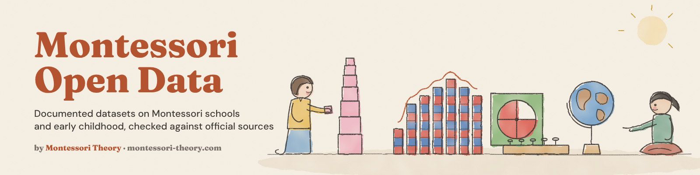

**Open, documented datasets on Montessori schools, early childhood and homeschooling.** CSV first, checked against the official source, free to reuse under CC BY 4.0, on GitHub, Kaggle and Hugging Face.

### 👉 [Browse The Full Catalog, Montessori Open Data](https://github.com/montessoritheory/montessori-open-data)

- 🏫 [US Montessori private schools, 1989-2024](https://github.com/montessoritheory/us-montessori-private-schools), 2,070 schools in 2023-24 and 37,543 school-year records from the NCES Private School Universe Survey
- 🗺️ Ready-made tables by state, city, county and locale, plus a GeoJSON map of every school
- 📈 AMS and AMI membership, enrollment, and the NCES weighted estimate (it matches the published 2,441 for 2021-22)
- 👶 [US early childhood care, 2016 and 2019](https://github.com/montessoritheory/us-early-childhood-care), who looks after children aged 0 to 5, hours, weekly cost and what parents look for, 12,936 children
- 🏡 [US school choice and homeschooling, 2016 and 2019](https://github.com/montessoritheory/us-school-choice-homeschooling), public, charter, private or homeschool and why, 30,521 students
- 🧸 [US public pre-K and kindergarten by state, 2010-2022](https://github.com/montessoritheory/us-public-prek-kindergarten), every grade by state and fall, plus 3- to 5-year-olds in school

More datasets on child development and early education are on the way.

Also on [Kaggle](https://www.kaggle.com/mariamontessori) and [Hugging Face](https://huggingface.co/montessoritheory). Data by [Montessori Theory](https://www.montessori-theory.com/), a site about Montessori at home.
